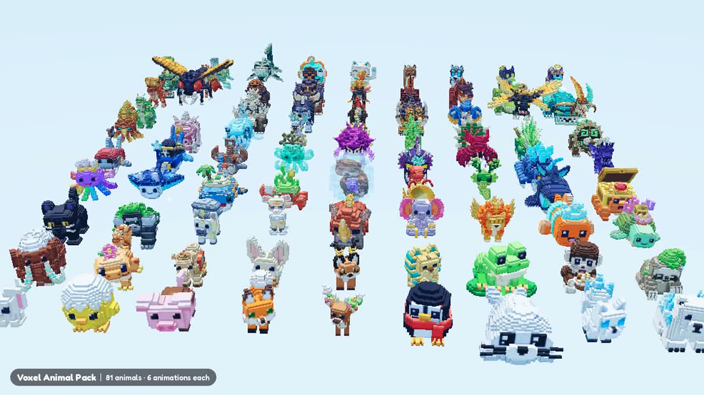
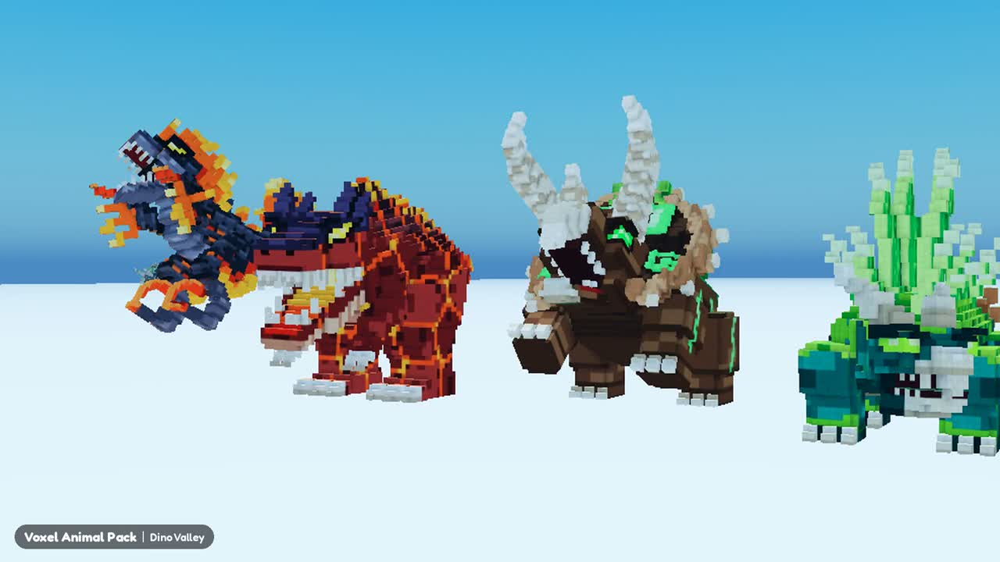
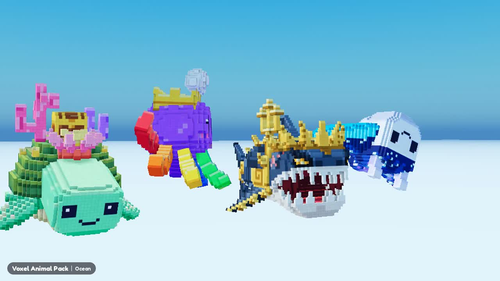
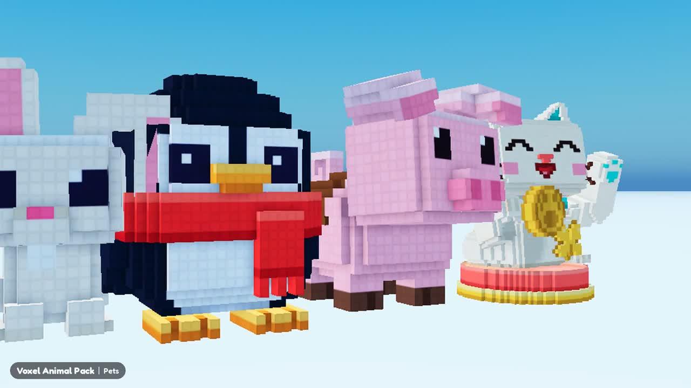
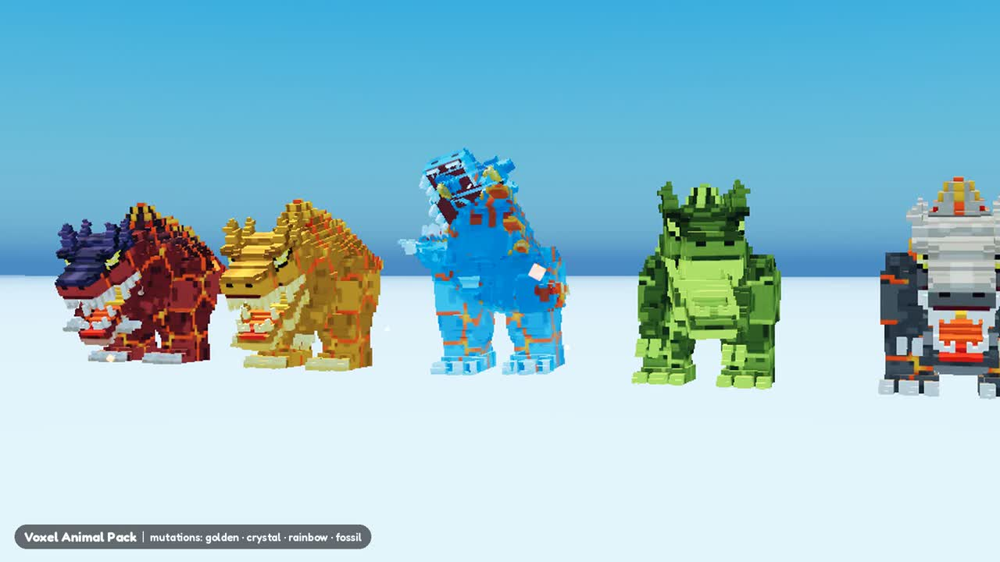

# Voxel Animal Pack for Roblox (free)

81 rigged voxel animals, ready to drop into your game. Every one walks, runs, eats, celebrates and has mutations. Nothing to upload or publish.

Made by **@momentumcash**. Free to use in your games.

▶ **[Watch the trailer](pics/trailer.mp4)**



## What you get

- **81 animals** from 3 worlds and 15 biomes: dinos, ocean creatures, savanna and forest animals, cute pets, plus a Guard Dog in 4 skins
- **6 animations on every animal:** Idle, Walk, Run, Eat, Celebrate, Spawn. They play by code, so you never upload an animation
- **Mutations:** Golden, Crystal, Rainbow, and Fossil for the dinos
- **A tiny kit** to spawn, move, animate and mutate them in one line each

|  |  |
|---|---|
|  |  |

## Set it up with your AI (easiest)

Connect Roblox Studio to Claude Code first: in Studio, **Assistant** > **...** > **Manage MCP Servers** > **Quick connect** > **Claude Code**. Open your game in Studio, then paste this into Claude Code:

```
Set up the Voxel Animal Pack for me from https://github.com/momentumcash/voxel-animal-pack
Download it, put files/Voxel Animal Pack.rbxm in ReplicatedStorage in my open Roblox Studio game,
spawn a few animals in front of the spawn with mutations, press Play and check they animate.
```

## Or set it up yourself (1 minute)

1. Download this repo: green **Code** button > **Download ZIP**, then unzip it.
2. In Roblox Studio, right-click **ReplicatedStorage** > **Insert from File** > `files/Voxel Animal Pack.rbxm`.
3. Keep the `CatchingAnimalsPack` folder in ReplicatedStorage. That's the whole setup.
4. Spawn one from any Script:

```lua
local Kit = require(game.ReplicatedStorage.CatchingAnimalsPack.Kit.VoxelAnimalKit)

local lion = Kit.spawn("Lion", CFrame.new(0, 0, -20))
Kit.setMutation(lion, "Golden")      -- Normal / Golden / Crystal / Rainbow / Fossil
Kit.play(lion, "Celebrate")          -- Eat / Celebrate / Spawn
Kit.setMotion(lion, "walk", 12)      -- idle / walk / run + speed
print(Kit.list())                    -- every animal id
```

Want a quick look first? Enable `Examples/SpawnExample` inside the pack and press Play.

## Licence

Free to use in your games, including ones that make money. Don't sell the pack itself.
